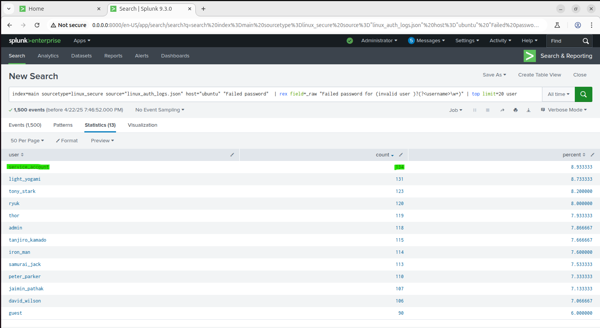
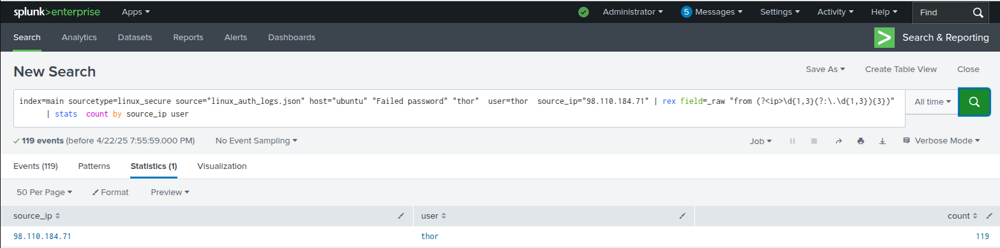
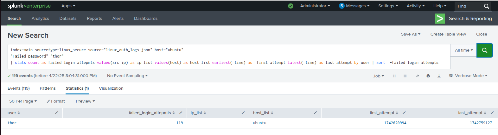

# 🛡️ Day #18 – Splunk: Investigating SSH Brute Force Attacks


---

# 🎯 Objective

Detect and investigate SSH brute-force attacks using Splunk by analyzing Linux authentication logs.

The investigation focuses on identifying:

- Suspicious usernames
- Source IP addresses
- Failed authentication patterns
- Indicators of unauthorized access attempts

This lab simulates a common SOC analyst workflow during an authentication abuse investigation.

---

# 🖥️ Lab Environment

| Component | Details |
|---|---|
| Operating System | Ubuntu Server 22.04+ |
| SIEM Platform | Splunk Enterprise / Free Edition |
| Log Source | `linux_auth_logs.json` |
| Sourcetype | `linux_secure` |
| Index | `main` |
| Host | `ubuntu` |

---

# 🧪 Lab Setup

## 1. Configure Splunk

Installed and configured Splunk for Linux authentication log analysis.

## 2. Import Authentication Logs

Imported:

```text
linux_auth_logs.json
```

Configured:

```text
source="linux_auth_logs.json"
sourcetype="linux_secure"
index="main"
host="ubuntu"
```

## 3. Begin Investigation

Opened:

```text
Search & Reporting
```

and performed SPL-based threat hunting.

---

# 🔍 Investigation Process

## 🔸 Question 1

## Which user attempted the most SSH brute force logins?

### SPL Query

```spl
index=main sourcetype=linux_secure source="linux_auth_logs.json" host="ubuntu"
"Failed password"
| rex field=_raw "Failed password for (invalid user )?(?<username>\w+)"
| stats count by username
| sort -count
```

### Evidence

📸 Screenshot:




### Finding

The query identified the username generating the highest number of failed SSH authentication attempts.

---

# 🔸 Question 2

## What is the IP address associated with user thor?

### SPL Query

```spl
index=main sourcetype=linux_secure source="linux_auth_logs.json" host="ubuntu"
"Failed password" "thor"
| rex field=_raw "from (?<ip>\d{1,3}(?:\.\d{1,3}){3})"
| stats count by ip
```

### Evidence

📸 Screenshot:



### Finding

The investigation extracted the source IP address responsible for failed login attempts against user `thor`.

---

# 🔸 Question 3

## How many times did user thor fail authentication?

### SPL Query

```spl
index=main sourcetype=linux_secure source="linux_auth_logs.json" host="ubuntu"
"Failed password" "thor"
| stats count
```

### Evidence

📸 Screenshot:



### Finding

The query calculated the total number of failed authentication attempts associated with user `thor`.

---

# 🧾 Evidence & Artifacts

Repository evidence:

```
📂 images/
│
├── q1-most-brute-user.png
├── q2-thor-ip.png
└── q3-thor-fail-count.png


📜 commands_used.md
```

Contains:

- SPL queries
- Investigation commands
- Analysis workflow


```
🧠 findings.md
```

Contains:

- Identified attack patterns
- Suspicious activity
- Analyst conclusions


```
📝 notes/conclusion.md
```

Contains:

- Security impact
- Lessons learned
- Recommendations

---

# 🚨 Incident Findings

The investigation demonstrated characteristics commonly associated with SSH brute-force attacks:

- Multiple failed authentication attempts
- Repeated targeting of user accounts
- Suspicious authentication patterns
- Potential unauthorized access attempts

---

# 🛡️ SOC Analyst Response Workflow

The investigation followed a standard incident response process:

| Phase | Action |
|---|---|
| Detection | Identified failed SSH authentication activity |
| Analysis | Used SPL queries to extract usernames and IPs |
| Investigation | Correlated authentication attempts |
| Containment | Recommended blocking malicious sources |
| Documentation | Recorded findings and evidence |

---

# 🧠 Lessons Learned

- Regular expressions are powerful for extracting fields from raw logs.
- Authentication failures can reveal attack patterns.
- SIEM tools allow analysts to quickly search large datasets.
- Identifying attacker IP addresses supports containment actions.
- SPL knowledge is essential for SOC analyst investigations.

---

# 🔐 Security Recommendations

Recommended defensive actions:

- Enable SSH key-based authentication
- Disable password authentication where possible
- Implement account lockout policies
- Restrict SSH exposure using firewall rules
- Deploy automated alerting for repeated failures
- Integrate authentication monitoring into SIEM dashboards

---

# 📚 MITRE ATT&CK Mapping

| Technique | Description |
|---|---|
| T1110 | Brute Force |
| T1110.001 | Password Guessing |
| T1078 | Valid Accounts |

---

# 📘 License

This project is licensed under the MIT License.
